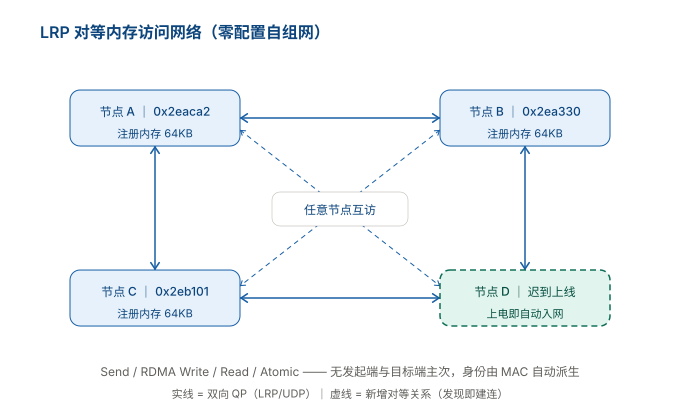
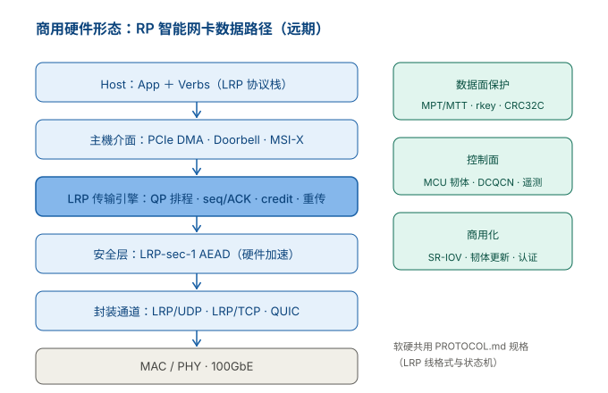
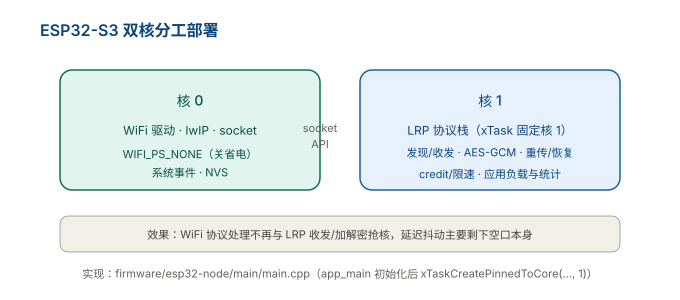

# LRP 全流程设计规格（对等内存访问网络 · 商用导向）

版本：0.3　语言：C++17（协议栈）/ SystemVerilog（RTL，远期）
权威规格：**线格式、状态机、握手、安全层与恢复机制以 `PROTOCOL.md`（LRP-1 / LRP-sec-2）为准**；本文档描述系统架构、实现现状与商用化路线。

---

## 1. 产品定位与范围

### 1.1 最终目标

采用**自研 LRP 协议**构建多设备**对等内存访问网络**：

- 设备不分生产批次、**任意时刻上电即自动入网**（零配置、零预分配标识符）；
- 任意节点间可执行 Send / RDMA Write / RDMA Read / Atomic，**无发起/目标主次关系**；
- 组网形态：同网段（同交换机/路由器 L2 域）**自组网发现**最佳；AP 隔离/跨网段时可经**网关兜底**；
- 典型场景：服务器机房多机互联、多设备数据采集与协同、边缘内存池。

商用形态演进：软件协议栈（已实现，ESP32 / 树莓派 / Linux）→ 多设备无线实验 → **RP 智能网卡硬件**（RTL 路线见 §6）。

### 1.2 功能范围

| 项目 | 规格 |
|---|---|
| 传输服务 | RC（可靠、有序、每对节点一对双向 QP） |
| 动词操作 | Send / RDMA Write / RDMA Read / Atomic（CAS、FAA） |
| 协议 | LRP-1（线格式/可靠传输）+ LRP-sec-2（AES-256-GCM 安全层），全自研可商用 |
| 承载通道 | LRP/UDP（已实现，主通道）、LRP/TCP（已实现）、LRP/QUIC（RoQ，规划） |
| 组网 | 零配置对等发现（组播+广播+种子兜底），迟到节点随时入网 |
| 身份 | 硬件 MAC 派生，免预分配标识符 |
| 流控/拥塞 | 每 QP credit 流控 + 轻量 AIMD 限速退避 |
| 可靠性 | RTT 自适应 RTO、闪断/重启双路径恢复、SRRESUME 续传、心跳死节点剔除 |
| 规模（演示） | 8~32 节点同网段（商用更大规模随硬件演进） |

### 1.3 设计原则

1. **自研协议优先**：LRP 线格式、状态机、握手为项目原创，不兼容、不引用 IBTA/IEEE 等第三方协议规格；代码禁止 GPL/未授权来源，开源依赖仅限 Apache-2.0/MIT/BSD 级。
2. **零配置对等**：设备上电即入网是产品底线特性；一切人工配置（静态 IP、预分配 ID、点名配对）都是需要消灭的对象。
3. **软硬同规格**：软件协议栈与硬件数据路径共用同一套 LRP 线格式与状态机（PROTOCOL.md），RTL 实现即规格的硬件化。
4. **可验证性**：每个模块有测试锚点（RFC 已知答案、单元测试、组网场景、损害注入）。

---

## 2. 系统架构总览

### 2.1 当前实现形态（软件对等网络）



### 2.2 商用硬件形态（远期，RP 智能网卡）



---

## 3. 协议栈实现（现状）

### 3.1 文件布局

```
include/rdma/types.hpp     枚举与常量（Opcode/WR/CQE/窗口）
include/rdma/pkt.hpp       LRP-1 线格式（10B 头/WEXT/AEXT/原子扩展/CRC32C）
include/rdma/aead.hpp      LRP-sec-2 AEAD 接口（GCM/CMAC/KDF）
include/rdma/verbs.hpp     Verbs API（Context/PD/MR/CQ/QP）
src/core.cpp               资源对象、QP 状态机、CM 通道工具
src/xport.cpp              RC 引擎（PSN/ACK、credit、AIMD、安全封装、重传）
src/aead.cpp               AES-256-GCM + CMAC-KDF 原创实现（过 FIPS-197/RFC 4493/NIST GCM 向量）
demo/cm_net.hpp            SRHELLO/SRWELCOME 两节点 CM
demo/demo_app.cpp          成对功能演示（Write/Send/Read/Atomic/延迟/吞吐）
demo/bench_app.cpp         测量套件（8B 往返×4 操作 + 1KB 吞吐，--psk/--rate-kbps）
demo/peer_app.cpp          ★ 对等零配置组网（主推演示形态）
tests/test_loopback.cpp    14 项测试（协议/安全/credit/限速/续传/RTO/管道）
firmware/esp32-node/       ESP32 固件工程（demo/bench/peer 五角色，menuconfig）
```

### 3.2 关键机制（与 PROTOCOL.md 对应）

- **可靠传输**：24-bit seq 环绕比较、累计 ACK、Go-Back-N、RNR/NAK、超时重传（50ms×3）；
- **credit 流控**：SEND 无信用时挂起排队、按 seq 序发出，零信用时对端主动通告；
- **轻量拥塞控制**：令牌桶限速 + AIMD（丢包减半、确认加性增长、重传绕过限速）；
- **安全层 LRP-sec-2**：AES-256-GCM，三层密钥（PSK → 会话密钥 → 世代子密钥），帧 = 头(AAD)|密文|tag|CRC32C，nonce=op|世代|seq，2^20 帧自动换代；
- **故障恢复双路径**：闪断=原 psn 立即重传（对端缓存续传）；对端重启=SRRESUME 边界分类续传（写直通/读重投/原子交应用）；
- **RTT 自适应 RTO**（SRTT+4·RTTVAR，20~1000ms）与**心跳死节点剔除**（15s）；
- **零配置入网**：身份 MAC 派生，SRDISCOVER/SROFFER/SRJOIN 三段发现，迟到节点透明加入；
- **重复抑制**：按 seq 缓存响应，重复帧重发缓存（原子操作不重复执行）。

### 3.3 测试锚点

`make test` 14 项：成对操作（Write/Send/Read/Atomic）、NAK 错误与链路复原、RNR 超时重传、TCP 通道、AES/CMAC/GCM 已知答案（FIPS-197/RFC 4493/NIST）、加密端到端与错密钥拒绝、credit 排队语义、限速下限断言、**SRRESUME 续传语义**（写直通/原子不确定/读重投）、**RTO 自适应**。

### 3.4 运行时部署（ESP32 双核）



---

## 4. 对等组网与零配置入网

详见 PROTOCOL.md §5。要点：

1. **身份**：`FNV1a(硬件 MAC ‖ 数据端口)` 低 24 位，上电自动派生；
2. **发现**：每 2s 组播 239.255.77.77 + 广播 + 可选种子，三通道兜底；
3. **建连**：SRDISCOVER → SROFFER → SRJOIN，每对节点一对双向 RC QP，互相获得 rkey/内存基址/credit/会话随机因子；
4. **迟到入网**：周期发现保证新旧节点双向互见，对已有网络无扰动；
5. **故障与续传**：建连报文携带 epoch/boundary；闪断原 psn 重传续传、对端重启走 SRRESUME 边界分类（详见 PROTOCOL.md §6.1）；
6. **心跳**：发现报文即心跳，15s 失联剔除节点，恢复后自动重新融入；
7. **网关兜底**：AP 隔离/跨网段时，`--seed ip:port` 或网关转发发现报文（gateway 模式）。

节点工作负载（peer 模式演示）：对每个对端周期执行 Atomic FAA（远端计数）、Write（心跳）、Read（回读校验），打印每对端 ops/rtt/远端计数——证明任意节点对等互访、无主次。

---

## 5. 承载通道

| 通道 | 状态 | 说明 |
|---|---|---|
| LRP/UDP | 已实现 | 主通道；WiFi/以太通用；无线实验载体 |
| LRP/TCP | 已实现 | 帧封装（4B 长度前缀），过内网/有线场景 |
| LRP/QUIC（RoQ） | 规划 | QP↔stream 映射，可靠性交给 QUIC 流；连接迁移抗换 IP；适合 WAN/移动场景 |

QUIC 映射草案（PROTOCOL.md 姊妹设计）：一 QP 一 stream、UD 走 DATAGRAM、控制面走 stream 0；安全由 QUIC TLS 承担时可关 LRP-sec-2。完整 QUIC 栈重（ESP32 不堪），务实路线是「QUIC-lite 流映射」先验证语义。

---

## 6. 商用硬件路线图（RTL，远期）

> 以下为 RP 智能网卡的硬件设计路线，与 LRP 协议栈共用 PROTOCOL.md 规格；线格式一律为 LRP 自研格式（非任何第三方 RDMA 规格）。

### 6.1 模块清单

| 模块 | 职责 | 关键指标 |
|---|---|---|
| `pcie_if` | PCIe Gen4 x8 端点、TLP 收发 | 16 GB/s 吞吐 |
| `dma_engine` | WQE 读取、payload DMA 读写、CQE 写回 | SGL、4KB burst |
| `doorbell_fifo` | doorbell 收集、去重、爆发缓冲 | 每 QP SQ/RQ |
| `qp_context_cache` | QP 上下文片上快取 | 4K~128K 条目 |
| `qp_scheduler` | 多 QP 公平排程（DWRR） | 每周期派发 |
| `tx_pipeline` | WR 解码 → 分段 → 封包 | First/Middle/Last |
| `transport_engine` | seq/ACK/credit/重传定时 | 窗口 64、24-bit 环绕 |
| `retransmit_buf` | 未确认帧重传缓冲（DDR4） | 256MB |
| `mpt_mtt` | 记忆体保护表、rkey 校验 | 查表 ≤2 拍 |
| `icrc` | CRC32C 产生与校验 | 线速 |
| `rx_parser` | LRP 帧解析、opcode 分派 | ≤3 拍 |
| `rx_placement` | 直达放置、CQE 产生 | 直写 host 记忆体 |
| `aead_engine` | LRP-sec-2 AES-GCM 加解密（硬件加速路径） | 线速 AEAD |
| `dcqcn` / `ecn_pfc` | 拥塞控制与无损乙太 | RP/NP 状态机 |
| `mcu` / `telemetry` | 管理面、遥测、除错 | 韧体 + 计数器阵列 |

### 6.2 TX / RX 数据路径

TX 五级：Fetch（doorbell 取 WR）→ Decode（lkey/边界校验）→ Segment（分段配 seq）→ Encap（LRP 头+AEAD+CRC32C）→ Xmit（入重传缓冲、DCQCN 闸门）。
RX：Parse（CRC/AEAD 校验）→ Lookup（QPN 查快取）→ Order（24-bit seq 比对、乱序回退）→ Place（rkey 校验后直写）→ Complete（ACK/CQE/MSI-X）。

### 6.3 关键数据结构（软硬接口示意，LRP 语义对应）

**WQE（64B 基本 + SGL）**：`wr_id(64) | opcode/flags/num_sge(24) | 保留 | 操作扩展(va64/rkey32/len32) | SGE×2`。
**CQE（16B）**：`wr_id(64) | status(8) | opcode(8) | byte_len(32)`。
**Doorbell（8B）**：`qp_num(24) | 计数(8) | wqe_index(24) | 标志(8)`。
**BAR0 寄存器**：能力、admin 队列、EQ/MSI-X、全局 CC 参数、VF 限速、韧体版本。

### 6.4 QP Context 与记忆体保护

QP 条目：qpn、类型、状态、remote_qpn、pmtu、SQ/RQ 基址与头尾、cqn、next_seq/expected_seq、credit、访问权限、重试参数。
MPT/MTT：key → {基址、长度、权限、页表}；每次远端访问做 key/权限/边界三重校验；key 含乱数成分；SR-IOV 下 VF 隔离。

### 6.5 RTL 划分与时脉

```
rtl/top / pcie / qp / tx / xport / prot / rx / aead / cc / eth / mcu / tb
```
核心 300MHz、MAC 156.25MHz（100G），重传缓冲 DDR4 256MB，片上 QP cache ~2MB；FPGA 原型估算与分阶段实现见里程碑。

---

## 7. 软硬接口与商用化必备

- **Admin Queue**：创建/销毁 QP·CQ·MR、修改状态、查询计数器；**Doorbell 頁**写 SQ/RQ tail。
- **驱动**：Linux rdma-core 风格 shim（自研 verbs 对接）；VFIO 用户态直驱快速路径。
- **商用化清单**：SR-IOV/IOMMU、DCQCN 与每 VF 限速、韧体 A/B 更新与看门狗、每 QP 遥测计数器、ECC、错误注入、PCIe 合规、LRP 一致性测试（注意：是 LRP 自身一致性，非第三方规格认证）、开源边界按项目许可模型（Apache-2.0 或专有）执行。

---

## 8. 验证计划

| 层级 | 内容 | 状态 |
|---|---|---|
| L0 | FIPS-197/RFC 4493/NIST GCM 向量、协议单元测试 14 项 | ✅ 已过 |
| L1 | 成对 demo/bench（功能/延迟/吞吐/PSK/限速） | ✅ 桌面已过 |
| L2 | 对等组网：零配置、错峰/迟到入网、N 节点互访 | ✅ 3 节点已过 |
| L3 | 损害注入：断链恢复/续传已验；丢包/乱序注入待补 | 进行中 |
| L4 | 2×ESP32-S3 实机（WiFi 延迟/吞吐/安全开销矩阵） | 待实机 |
| L5 | 多节点实机 + 移动/漫游场景 | 规划 |
| L6 | RTL 仿真（Verilator/cocotb）、FPGA 原型 | 远期 |

---

## 9. 里程碑

| 里程碑 | 内容 | 状态 |
|---|---|---|
| M1 | LRP-1/LRP-sec-2 规格与实现、Verbs/RC 引擎、UDP/TCP 通道、credit/CC、零配置对等组网、可靠性四件套（恢复/续传/心跳/自适应 RTO）、测量套件、14 项测试 | ✅ 已完成 |
| M2 | 2×ESP32-S3 实机验证（三轮矩阵：明文/PSK/限速）、双核分工调优、N 节点扩展 | 进行中 |
| M3 | 无线信道实验（丢包/距离/移动）、QUIC-lite(RoQ) 通道 | 规划 |
| M4 | 网关模式与跨网段、损害注入 L3 完整化 | 规划 |
| M5 | RTL 传输引擎 + DMA + 仿真（§6 模块） | 远期 |
| M6 | FPGA 原型 + PCIe 主机接口 + 商用化清单 | 远期 |
