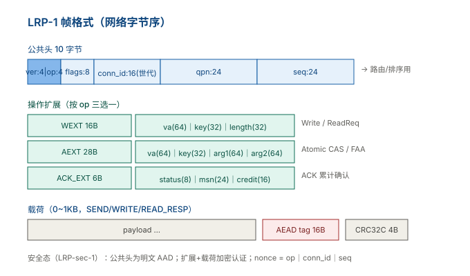
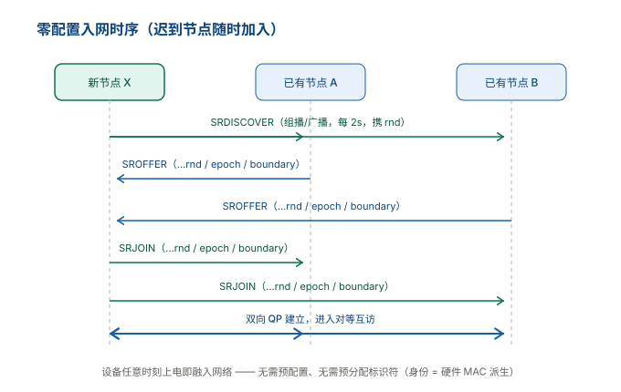
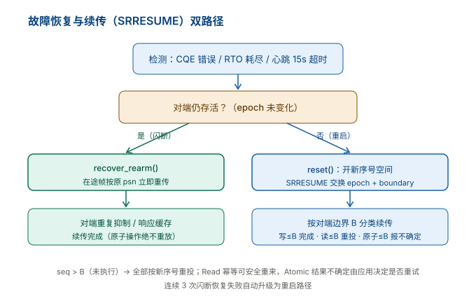
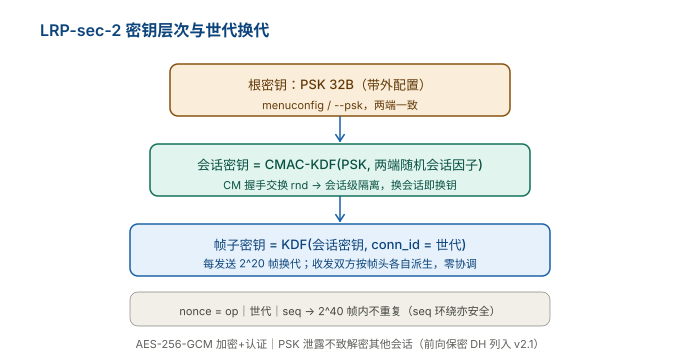

# LRP：轻量 RDMA 传输协议（自研协议规格）

版本：0.4（代号 LRP-1 + LRP-sec-2）　状态：已实现（`include/rdma/pkt.hpp`、`src/xport.cpp`、`src/aead.cpp`）
归属：本协议规范与实现均为项目自研成果，可商用；不兼容、不引用 IBTA/IEEE 等第三方协议规格的线格式。

---

## 1. 目标与范围

在 UDP/IP 之上提供面向内存注册模型的**单边远程内存访问**传输服务：

- 操作原语：Send、RDMA Write（单边写）、RDMA Read（单边读）、Atomic CAS / FAA
- 可靠传输：有序递交、确认与重传、重复抑制
- 传输通道：QP 风格队列对（发送队列 / 接收队列 / 完成队列）
- 目标平台：嵌入式 Linux 与 MCU（ESP32 等）、WiFi 与以太网

非目标（v1）：多播、乱序直达放置、多路径、拥塞控制（v2 见 §8）。

## 2. 术语

| 术语 | 含义 |
|---|---|
| 通道（QP） | 双向传输通道，带 24-bit 通道号 |
| 传输项（WR） | 发起方投递的工作请求 |
| 完成项（CQE） | 操作完成事件 |
| 注册内存（MR） | 经登记的连续内存区，带 32-bit 访问键 key 与权限 |
| seq | 24-bit 帧序号，环绕比较 |
| conn_id | 16-bit **帧密钥世代**（每发送 2^20 帧换代，见 §7.2；同时预留连接迁移扩展） |

## 3. 帧格式（LRP-1，网络字节序）



所有帧 = 10 字节公共头 + 操作扩展 + 载荷 + 4 字节 CRC32C。

### 3.1 公共头（10 字节）

```
偏移  字段      宽度   说明
0     ver|op    8      高 4 位版本(=1)，低 4 位操作码
1     flags     8      标志位
2     conn_id   16     密钥世代(每 2^20 帧换代)
4     qpn       24     目的通道号
7     seq       24     请求序号 / 确认号
```

### 3.2 操作码

| op | 名称 | 扩展 | 载荷 | 说明 |
|---|---|---|---|---|
| 0x0 | SEND | 无 | 有 | 双边消息，目的方取接收队列位置 |
| 0x1 | WRITE | WEXT(16B) | 有 | 单边写直达注册内存 |
| 0x2 | READ_REQ | WEXT(16B) | 无 | 单边读请求 |
| 0x3 | READ_RESP | 无 | 有 | 读响应，seq 回显请求序号 |
| 0x4 | ATOMIC_CAS | AEXT(28B) | 无 | 比较并交换（8 字节） |
| 0x5 | ATOMIC_FAA | AEXT(28B) | 无 | 取回并加（8 字节） |
| 0x6 | ATOMIC_ACK | 原值(8B) | 无 | 原子响应，seq 回显请求序号 |
| 0x7 | ACK | ACK_EXT(4B) | 无 | 累计确认 |

### 3.3 操作扩展

```
WEXT(16B):  va(64) | key(32) | length(32)
AEXT(28B): va(64) | key(32) | arg1(64) | arg2(64)
           CAS: arg1=compare, arg2=swap; FAA: arg2=addend
ACK_EXT:   status(8) | msn(24) | credit(16)
           msn=累计确认(下一期望序号); credit=对端可用接收信用(绝对值)
```

### 3.4 标志位与状态码

flags：bit0=RNR（接收队列空），bit1=NAK（请求非法）。
status：0x00=成功确认，0x81=请求非法（键/权限/越界），0x82=RNR。

### 3.5 校验

帧尾 CRC32C（Castagnoli，反射实现），覆盖公共头+扩展+载荷。

## 4. 操作语义

- **SEND**：发送方载荷 ≤ 单帧上限（1KB）；目的方从接收队列取位置放置，产生双边完成。
- **WRITE**：校验 key 与 REMOTE_WRITE 权限后直达放置；仅发起方产生完成，目的方无完成事件。
- **READ**：目的方校验 REMOTE_READ 后回 READ_RESP；发起方收到响应产生完成。
- **ATOMIC**：目的方在 8 字节对齐地址原子执行，原值经 ATOMIC_ACK 返回；重复请求（seq < 期望）只重发缓存响应，不重复执行。

## 5. 连接管理与零配置入网

### 5.1 节点身份（自动派生，免预分配）

节点身份 = `FNV1a(硬件 MAC ‖ 数据端口)` 低 24 位，上电自动生成。设备无需预配置、无需预分配任何标识符；同一协议的设备烧录同一固件即具备入网能力。

### 5.2 对等发现（自组网，无主次）



所有节点运行同一固件、角色完全对等。控制通道（数据端口 +100）每 2s 发出发现报文（三个兜底通道：组播 239.255.77.77、广播、可选种子地址）：

```
SRDISCOVER  node=<身份> data_port=<数据端口> rnd=<会话因子>
SROFFER     node=<身份> data_port=… qpn=<本端为该对分配的QP> rkey=… base=… credit=…
            rnd=… epoch=<连接纪元> boundary=<已完成 seq 边界>
SRJOIN      node=<身份> data_port=… qpn=… rkey=… base=… credit=… rnd=… epoch=… boundary=…
SRRESUME    node=<身份> data_port=… rnd=… epoch=… boundary=…   （故障恢复时补发）
```

- 发现即建连：每对节点建立一对双向 RC QP，任意节点可对任意节点做 Send/Write/Read/Atomic，无发起/目标主次之分。
- **迟到入网**：设备任意时刻上电，通过周期发现与已有节点双向互见并入网；新节点的出现对已有节点透明。
- 配置要求：仅 WiFi 凭据（入网媒介）；IP 走 DHCP，端口用协议默认值。
- 兜底：AP 隔离/跨网段过滤组播时，可配置种子地址或经网关转发发现报文（gateway 模式）。

### 5.3 点对点 CM（bench/demo 模式保留）

`SRHELLO/SRWELCOME` 用于显式两节点连接（测量/演示工具链）。

## 6. 可靠传输与流控规则

- 每个请求帧分配一个 seq；发送窗口默认 64 个未完成项。
- 确认为累计式：ACK.msn = 下一期望 seq；发送方完成所有 seq < msn 的双边项。
- **credit 流控**：仅 SEND 消耗接收信用（credit = 对端已投递未消费的接收项数）。发送方无信用时 SEND **挂起排队**（不报错），收到 ACK 携带的 credit 或对端 credit 通告后按 seq 序发出；接收队列空时回 RNR 作为兜底。接收方 post_recv 后若此前通告信用为 0，主动发 credit 通告帧（即普通 ACK）。
- READ/ATOMIC 项仅凭对应响应完成，不被 ACK 提前完成（响应可能丢失）。
- 超时重传同一帧，最多 3 次；**RTO 为 RTT 自适应**（SRTT+4·RTTVAR，钳位 20~1000ms，Karn 算法只取未重传样本）。
- 乱序（seq > 期望）：回 ACK(msn=期望)，发送方回退重传（Go-Back-N）。
- 重复（seq < 期望）：重发缓存响应。
- RNR（接收队列空）：回 ACK(status=RNR)，不推进期望序号，发送方超时重试。
- **轻量拥塞控制（AIMD）**：每 QP 令牌桶限速（可配 kbps，0=不限）；挂起帧按 seq 序受令牌门控。丢包信号（NAK 或超时重传）使速率减半（下限 max/32），累计确认推进时加性增长（步长 max/32，上限 max）。重传帧绕过限速直接发出。

### 6.1 故障恢复与续传（SRRESUME）



两类故障两条恢复路径：

1. **闪断（对端仍存活）**：`recover_rearm`——在途帧按**原 psn 立即重传**，由对端重复抑制/响应缓存
   （窗口深度覆盖全部在途）完成续传：写/读安全，原子操作绝不重复执行。
2. **对端重启（epoch 变化）**：`SRRESUME` 机制——建连报文（SROFFER/SRJOIN/SRRESUME）携带
   `epoch`（连接纪元）与 `boundary`（本端已完成的 seq 边界 = expected_psn-1）。重启方开新序号空间，
   在途操作按对端边界分类续传：
   - seq ≤ boundary 的 Write/Send → 对端已执行 → 本地直接完成（Success）
   - seq ≤ boundary 的 Read → 对端已执行但结果丢失 → **幂等重投**（新序号重新请求）
   - seq ≤ boundary 的 Atomic → 结果不确定 → 以 GeneralErr 完成（是否重试由应用决定）
   - seq > boundary → 未执行 → 按新序号重投

### 6.2 心跳与死节点剔除

对等节点每 2s 发现报文即心跳；**15s 未见**即判定失联：拆除 QP、停止向其发送、等待重新发现后走 SRRESUME 恢复。

## 7. 安全层 LRP-sec-2（已实现）

### 7.1 算法

- **AES-256-GCM**（SP 800-38D）：加密 + 认证一体化；密钥 32B、nonce 12B、tag 16B。
- **AES-CMAC**（RFC 4493）作为密钥派生 PRF；AES 实现含 AES-128/256（FIPS-197）。
- 全部为本项目原创实现，已知答案测试通过：FIPS-197 分组向量、RFC 4493 CMAC 向量、NIST GCM 向量（零密钥空/16B 载荷）。

### 7.2 密钥管理（三层结构）



```
PSK(32B, 带外配置,根密钥)
 └─ 会话密钥 = CMAC-KDF(PSK, "LRP-sec-2 session", 两端随机会话因子按序拼接)
     └─ 帧子密钥 = CMAC-KDF(会话密钥或 PSK, "LRP-sec-2 blk", conn_id 世代)
```

- **会话因子**：CM 握手（SRHELLO/SRWELCOME/SRDISCOVER 族报文）交换 16 字节随机会话因子；
  双方各自派生同一会话密钥（因子排序拼接，方向无关）。会话密钥隔离 PSK 泄露后的历史会话
  （前向保密需再叠加 DH 协商，见 §8）。
- **世代换代（解决 nonce 寿命）**：帧头 conn_id 字段携带 16-bit 世代，每发送 2^20 帧换代；
  实际加密密钥按世代派生。接收方按帧头世代派生同一子密钥，无需协调。
  (op, 世代, seq) 组合在 2^40 帧内不重复——即使 24-bit seq 环绕也无 nonce 复用。
- **内容固定原则**：同一 (op, seq) 的密文只构建一次（请求缓存、响应缓存、ACK 按 msn 缓存），
  重发一律重发原字节；credit 变化需换内容时强制换世代，保证同一 nonce 永不对应两种明文。
- **回退模式**：未协商会话密钥时以 PSK 直接作根密钥（世代机制同样生效）。

### 7.3 帧保护

安全态帧：`公共头(10B 明文 AAD) | 密文(扩展+载荷) | tag(16B) | CRC32C(4B)`。
公共头不加密以便路由解析，但被 GCM 认证覆盖（不可篡改）；校验顺序：CRC32C 廉价查错 →
GCM 认证（失败静默丢弃）。nonce(12B) = `000000 00 | op(8) | conn_id=世代(16) | seq(24)`。

### 7.4 防重放

seq 顺序检查 + 重复帧缓存抑制（原子操作绝不重复执行）+ GCM 认证防伪造；
旧帧重放只会命中缓存重发路径。

## 8. v2.1 规划

前向保密（X25519 DH 临时密钥协商，叠加于 PSK 之上）、mbedTLS AES-GCM 硬件加速后端（ESP32）、
主动 REKEY 报文（长会话中途换代）、移动漫游的连接迁移、多包消息分段（First/Middle/Last）。

## 9. 代码来源与许可清单

| 部分 | 来源 | 许可 |
|---|---|---|
| 协议实现（include/、src/、demo/、firmware/） | 本项目自研（原创编写） | 归属本项目，可商用 |
| CRC32C | 公开数学算法的原创实现 | 无版权约束 |
| 操作系统接口（POSIX socket、lwIP socket API） | 系统 API 调用 | 不涉及代码复制 |
| ESP-IDF | Espressif | Apache-2.0（可商用） |
| FreeRTOS | Amazon | MIT（可商用） |
| lwIP | Swedish Institute of Computer Science | BSD（可商用） |
| mbedTLS（v2 安全层拟用） | Arm | Apache-2.0（可商用） |

审计结论：仓库内无 GPL/LGPL 代码、无未授权第三方源码、无第三方协议规格的线格式复制。
代码标识符（Qp/Cq/Mr 等）为通用英文缩写，不构成第三方知识产权要素；协议的线格式、状态机与握手均为原创。

## 10. 商用与发布建议

- 权利人可对本协议与实现自由商用；
- 若对外开源，建议采用 Apache-2.0（与项目许可模型一致）并保留本规格的版权声明；
- 对外文档宣称兼容性时，勿使用 IBTA/IEEE 名义（本协议不兼容任何第三方 RDMA 规格）。
