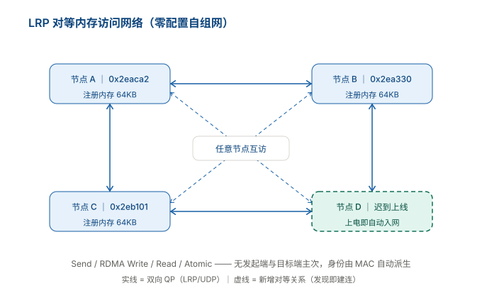

# LRP — 轻量 RDMA 传输协议

面向无线与嵌入式场景的**对等内存访问网络**协议栈：设备上电即自动入网、任意节点互读写内存（Send / RDMA Write / Read / Atomic）、AES-256-GCM 加密、断线自愈续传。全自研协议与实现，C++17，无第三方协议栈依赖。

> 状态：已完成真机验证（2×ESP32-S3，WiFi 环境，零配置组网／远距离边界／断线恢复／性能矩阵）。商用硬件（RP 智能网卡）路线见 DESIGN.md。

## 核心特性

- **零配置对等组网**：无 server/client 主次，身份由硬件 MAC 自动派生，组播+广播发现，设备任意时刻上电即融入网络
- **单边内存访问**：Write / Read / Atomic（CAS/FAA）直达对端注册内存，目标端应用零参与
- **可靠传输**：24-bit 序号、累计 ACK、Go-Back-N、RNR、credit 流控、**永不放弃序号**（断链期间静默积压，信号恢复自动补洞）
- **故障恢复**：闪断原序号重传；对端重启走 SRRESUME 边界续传（写直通／读幂等重投／原子交应用）；心跳死节点剔除与自动重入网
- **安全层 LRP-sec-2**：PSK → 会话密钥 → 世代子密钥三层派生（AES-CMAC-KDF），AES-256-GCM 加解密，nonce 按 op|世代|seq 构造 2^40 帧不重复
- **管理面 SRCTL**：受信任设备（PC）远程下发限速／测量／查询指令（密钥鉴权），无需改固件角色
- **测量与观测**：内置性能测量（四操作延迟 + 吞吐）、UDP 日志回传、双串口监控工具

## 架构



更多图：[LRP-1 帧格式](pic/proto-lrp-frame.svg) · [密钥层次](pic/proto-key-hierarchy.svg) · [故障恢复](pic/proto-recovery-flow.svg) · [零配置入网](pic/proto-join-flow.svg) · [商用网卡路线](pic/arch-nic-pipeline.svg) · [ESP32 双核部署](pic/arch-dual-core.svg)

## 仓库结构

```
include/rdma/     协议头（线格式 pkt.hpp / Verbs 接口 / AEAD）
src/              协议实现（core / xport 引擎 / aes 加解密）
demo/             演示与工具（peer 对等组网 / bench 测量 / demo 成对演示 / cm 握手）
firmware/         ESP32 固件工程（ESP-IDF，peer/bench/demo 角色 menuconfig 切换）
tests/            协议测试（14 项：操作/可靠性/安全/KAT/续传/自适应 RTO）
scripts/          现场工具（ctl.py 管理指令 / collect_udp.py 日志收集 / monitor_dual.sh）
pic/              架构与协议图（SVG）
DESIGN.md         系统设计与商用化路线
PROTOCOL.md       LRP 协议规格（线格式/状态机/恢复/安全，权威文档）
```

## 快速开始

### 桌面验证（零硬件，macOS/Linux）

```bash
make test          # 14 项协议测试
make peer bench demo

# 双节点对等组网（本机两个进程即两个节点）
./demo/rdma_peer --port 18515 --seed 127.0.0.1:18516 &
./demo/rdma_peer --port 18516 --seed 127.0.0.1:18515 &

# 管理通道:远程限速 / 测量(结果经 UDP 回传)
python3 scripts/collect_udp.py &
python3 scripts/ctl.py 127.0.0.1 --port 18515 rate 2048
python3 scripts/ctl.py 127.0.0.1 --port 18515 bench 100 64
```

### ESP32 双节点（ESP-IDF v5.x）

```bash
cd firmware/esp32-node
idf.py set-target esp32s3
idf.py menuconfig     # RDMA Node 配置:角色 peer、WiFi、日志回传、管理密钥
idf.py build flash monitor
```

两块板烧同一份固件（角色相同即可），先后上电即自动互见。默认配置中的 WiFi 名／管理密钥仅供测试，**部署前请在 menuconfig 修改**。

## 真机实测摘要（2×ESP32-S3 · 2.4G WiFi）

| 项目 | 结果 |
|---|---|
| 零配置入网 | 上电 < 5s 完成发现+建连（判据 10s） |
| 8B 往返（明文） | avg 12.5~13.7ms（WiFi 空口主导） |
| 加密开销（PSK） | 延迟 +26~52%，吞吐约 1/4（软件 AES，硬件加速在路线图） |
| 传输边界 | 5m 遮挡可用 ↔ 10m 遮挡不可用（持续重试不死锁） |
| 断电重入网 | < 1s（epoch 变化检测 + 序号重建续传） |
| 纯断流自愈 | ≤ 5s（心跳 15s 剔除后自动恢复，积压操作补发） |
| 对等互访 | 双向 ops 恒定 2.5/s，远端 Atomic 计数持续增长 |

实验记录模板见 [RDMA实机验证记录表.pdf](RDMA实机验证记录表.pdf)。

## 开发路线

- **已完成**：LRP-1/LRP-sec-2 规格与实现、Verbs/RC 引擎、UDP/TCP 通道、credit 流控、AIMD 限速、零配置组网、SRRESUME 续传、SRCTL 管理面、14 项测试
- **进行中**：真机矩阵补全、限速×RTO 调优
- **规划**：mbedTLS 硬件 AES 后端、QUIC-lite(RoQ) 通道、多帧分段、RTL 传输引擎（商用网卡）

## 许可

Apache License 2.0（见 [LICENSE](LICENSE)）。版权所有 2026 狗天下/Dogworld（见 [NOTICE](NOTICE)）。协议与实现均为自研，线格式不兼容任何第三方 RDMA 规格；第三方依赖仅使用可商用开源许可（ESP-IDF / FreeRTOS / lwIP 等，见 PROTOCOL.md §9）。
